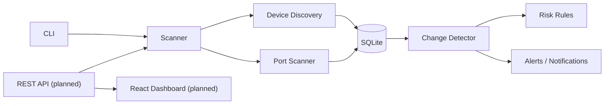
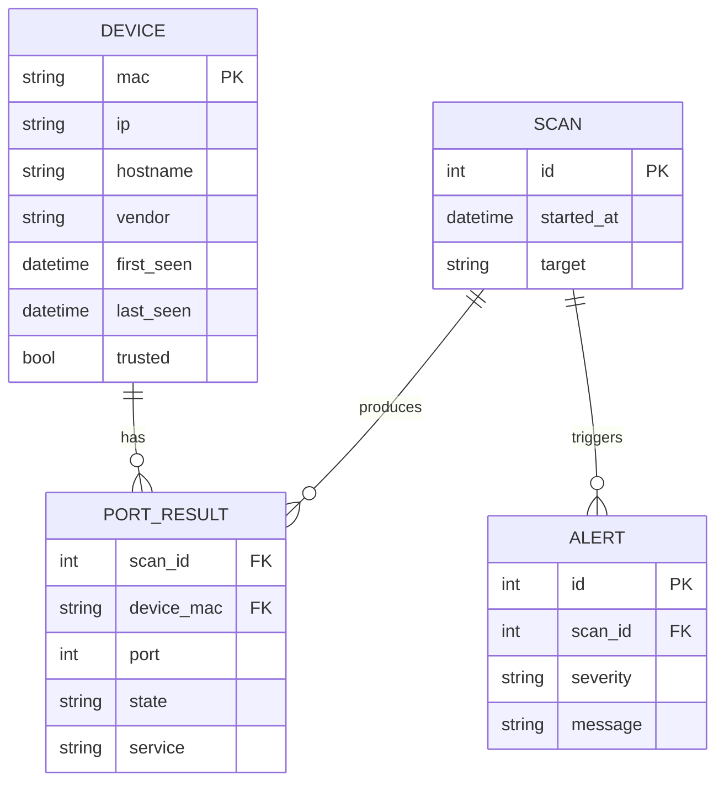

# Architecture

This document describes how NetGuard is designed and why. Components marked *(planned)* are not yet implemented — see the [roadmap](ROADMAP.md).

## Goals

- **Defensive by design** — monitor networks the user owns; detect unexpected changes.
- **Simple to run** — a single Python package, no external services required.
- **Modular** — scanning, storage, detection, and presentation are independent so each can be tested and replaced on its own.

## High-level overview

## Components

| Module | Responsibility | Status |
|---|---|---|
| `host_info` | Hostname and local IP detection | Done |
| `port_scanner` | Concurrent TCP connect scan; reports open / closed / filtered and service names | Done |
| `discovery` | Find devices on the LAN via ARP / ping sweep | Planned |
| `storage` | Persist devices, scans, and baselines in SQLite | Planned |
| `detector` | Compare the latest scan against the baseline and emit changes | Planned |
| `risk` | Rules that rate open services by risk | Planned |
| `cli` | `netguard info` and `netguard scan` subcommands (argparse) | Done |
| `api` + dashboard | FastAPI backend and React frontend | Planned |

### Design rule: scanning returns data, it does not print

Every scanner returns structured results (dataclasses). Only the presentation layer (CLI, API) formats output. This keeps the core logic testable and lets the same results feed the terminal, the database, and the dashboard.

## Data model *(planned)*

Devices are identified by **MAC address** rather than IP, because IPs change with DHCP.

## Key decisions

| Decision | Choice | Reason |
|---|---|---|
| Language | Python | Strong networking ecosystem (`socket`, `scapy`), fast to iterate |
| Port scan method | TCP connect scan | Works without root privileges; reliable |
| Storage | SQLite | Zero setup, single file, sufficient for one network |
| Concurrency | Thread pool | Network I/O–bound workload; simple and effective |
| CLI parsing | `argparse` | Standard library, no extra dependency; subcommands built in |
| Service names | Built-in table, then the OS services database | Same answer on every OS for common ports, still covers the rest |
| API | FastAPI | Typed, auto-generated docs, async-ready |

Larger decisions can be recorded as ADRs in `docs/adr/` as the project grows.

## Security & ethics

NetGuard is intended **only for networks you own or are authorized to test**. Scanning networks without permission may be illegal. The tool performs non-intrusive TCP connect scans and does not attempt exploitation.
